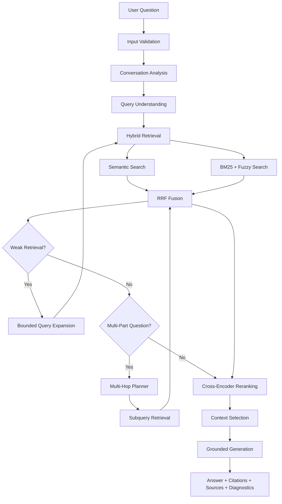

# Insurellm-RAG — Local-First Conversational RAG Assistant

A modular, local-first **Retrieval-Augmented Generation (RAG)** system that answers questions using only the Insurellm Knowledge Base.

The project combines **hybrid retrieval, semantic embeddings, BM25, fuzzy matching, Reciprocal Rank Fusion (RRF), cross-encoder reranking, query rewriting, bounded query expansion, multi-hop retrieval, conversation-aware follow-ups, grounded generation, and citation validation** into a single production-style RAG pipeline.

The system is designed to run locally using **Ollama, ChromaDB, Sentence Transformers, and Gradio**, with optional CUDA acceleration for embedding and reranking models.

> **Validation:** The system has been validated locally against the real Insurellm Knowledge Base, Ollama, the actual embedding and reranking models, and an NVIDIA RTX 4050 Laptop GPU. The validated Knowledge Base contains 76 Markdown documents and 474 indexed chunks.

---

## Demo

**Live Demo:** Coming soon

**GitHub:** `https://github.com/khaledAlzeer/Insurellm-RAG`

The project is currently validated locally and is being prepared for public deployment.

---

## Overview

Insurellm-RAG follows one core principle:

> **If the Knowledge Base does not contain enough evidence, the assistant should say so instead of guessing.**

The system separates conversation context from factual evidence, validates generated retrieval queries, protects against retrieval drift, checks citations against retrieved documents, and abstains when the available evidence is insufficient.

The application is implemented as a modular RAG system rather than a single notebook or script, allowing retrieval, generation, ingestion, evaluation, and UI components to be tested and improved independently.

---

## Key Features

- **Local-first architecture** — no paid LLM API required for the default workflow.
- **Ollama + `llama3.2`** for local generation.
- **Local semantic embeddings** using `all-MiniLM-L6-v2`.
- **CUDA acceleration** for embeddings and reranking when available.
- **Hybrid retrieval** combining semantic search and BM25.
- **Fuzzy lexical matching** for typo and acronym variations.
- **Reciprocal Rank Fusion (RRF)** for combining retrieval signals.
- **Cross-encoder reranking** over a bounded candidate set.
- **Conversation-aware retrieval** for follow-up questions.
- **Topic-shift detection** to prevent irrelevant context carryover.
- **Deterministic follow-up rewriting** with optional LLM-assisted rewriting.
- **Entity-preserving query validation** to reduce retrieval drift.
- **Bounded query expansion** for difficult or unknown terms.
- **Selective multi-hop retrieval** for multi-part questions.
- **Grounded generation** using retrieved context as the source of truth.
- **Citation validation** against retrieved source labels.
- **Explicit abstention** when evidence is insufficient.
- **Prompt-injection-resistant context handling**.
- **Incremental, non-destructive ingestion** with change detection.
- **Stable chunk IDs** based on document/content information.
- **Resumable ingestion and orphan reconciliation**.
- **Gradio conversational UI** with retrieved-context cards and diagnostics.
- **Structured `RAGResponse`** containing answers, sources, retrieved chunks, timings, warnings, and errors.
- **Retrieval evaluation framework** with Recall@K, Precision@K, MRR, nDCG@K, and Hit@K.
- **Answer-level evaluation** for factual coverage, abstention, and source attribution.

---

# Architecture



### Application layers

```text
Gradio UI
    ↓
service.py
    ↓
pipeline.py
    ├── retrieval/
    ├── generation/
    └── ingestion/
```

The UI does not directly manage embeddings, ChromaDB, or Ollama. Those responsibilities remain inside the service and pipeline layers.

---

# RAG Pipeline

The pipeline follows several controlled stages:

```text
Question
    ↓
Conversation / Topic Analysis
    ↓
Query Understanding
    ↓
Semantic Search + BM25
    ↓
RRF Fusion
    ↓
Optional Query Expansion
    ↓
Optional Multi-Hop Planning
    ↓
Cross-Encoder Reranking
    ↓
Context Selection
    ↓
Grounded Generation
    ↓
Citation Validation
    ↓
Final Response
```

The system intentionally avoids routing every retrieval decision through an LLM.

LLM calls are used selectively for operations such as rewriting, expansion, planning, and final generation.

---

# RAG Techniques

| # | Technique | Implementation |
|---|---|---|
| 1 | Structure-aware preprocessing and chunking | `ingestion/preprocessing.py`, `chunking.py` |
| 2 | Local semantic embeddings | `ingestion/embeddings.py` |
| 3 | Conversation-aware rewriting | `conversation.py`, `retrieval/query.py` |
| 4 | Bounded query expansion | `pipeline.py`, `retrieval/query.py` |
| 5 | Hybrid retrieval | `retrieval/lexical.py`, `retrieval/hybrid.py` |
| 6 | Reciprocal Rank Fusion | `retrieval/hybrid.py` |
| 7 | Cross-encoder reranking | `retrieval/reranking.py` |
| 8 | Context selection | `retrieval/context.py` |
| 9 | Grounded citation-aware generation | `generation/prompts.py`, `pipeline.py` |
| 10 | Conversation-aware multi-hop retrieval | `conversation.py`, `retrieval/query.py`, `pipeline.py` |

---

# Difficult Retrieval Cases

The system was specifically developed and tested against several common RAG failure modes.

## Acronym and Typo Mismatch

For example:

```text
IIOYT
IIOTY
```

The system can use bounded fuzzy lexical matching to identify close terms while preserving the original user query.

Instead of silently changing the question, retrieval records the relationship:

```text
Question term: IIOYT
Closest retrieved term: IIOTY
```

The final answer is only allowed to use the retrieved evidence.

---

## Unknown Entities and Unsupported Questions

For questions where the Knowledge Base does not provide sufficient evidence, the system is designed to abstain rather than rely on the LLM's outside knowledge.

Example:

```text
What is Manchester University?
```

The retrieval layer checks whether the requested entity is actually supported by retrieved evidence before generation.

---

## Follow-Up Questions

A conversation such as:

```text
Tell me about Lisa Anderson.

What is her role?
```

can be converted into a standalone retrieval query:

```text
What is Lisa Anderson's role?
```

The conversation layer is used to resolve references such as `her`, but previous conversation text is not automatically treated as factual evidence.

Topic shifts are handled separately to prevent unrelated information from carrying into a new question.

---

## Multi-Hop Questions

Questions containing multiple factual requirements can be decomposed into independent retrieval queries.

For example:

```text
Who is Marcus Johnson and what award did he receive?
```

may produce:

```text
Marcus Johnson role
Marcus Johnson award
```

The retrieved evidence is combined before grounded generation.

### Current limitation

Multi-hop retrieval is currently **parallel and independent rather than iterative**.

A second retrieval step does not automatically receive newly discovered information from the first step. Dependent-hop reasoning is therefore a potential future improvement.

---

# Technology Stack

| Component | Technology |
|---|---|
| Language | Python |
| Package / Environment Manager | `uv` |
| LLM Runtime | Ollama |
| Default LLM | `llama3.2` |
| Embeddings | `sentence-transformers/all-MiniLM-L6-v2` |
| Embedding Dimension | 384 |
| Vector Database | ChromaDB |
| Lexical Retrieval | BM25 |
| Reranker | `cross-encoder/ms-marco-MiniLM-L-6-v2` |
| UI | Gradio |
| Validation | Pydantic |
| Testing | pytest |
| GPU Acceleration | CUDA / PyTorch |
| Configuration | Environment variables + `.env` |

---

# Local Model Configuration

### Chat Model

```text
llama3.2
```

The project uses Ollama for local inference:

```text
http://localhost:11434
```

The default workflow does not require OpenAI or another paid inference provider.

### Embedding Model

```text
sentence-transformers/all-MiniLM-L6-v2
```

### Reranker

```text
cross-encoder/ms-marco-MiniLM-L-6-v2
```

Embedding and reranking can use CUDA when supported hardware is available.

---

# GPU Validation

The project was validated locally using:

```text
GPU:
NVIDIA GeForce RTX 4050 Laptop GPU

CUDA:
Available

Embedding device:
cuda

Reranker device:
cuda
```

CUDA-enabled PyTorch was used during local validation.

---

# Requirements

- Python 3.11+
- `uv`
- Ollama
- Git
- Sufficient disk space for local models and vector data
- NVIDIA GPU + CUDA is optional but recommended for faster embedding/reranking

The current development environment was validated on Windows 11 with Python 3.12 and an NVIDIA RTX 4050 Laptop GPU.

---

# Installation

## 1. Clone the repository

```powershell
git clone https://github.com/khaledAlzeer/Insurellm-RAG.git
cd Insurellm-RAG
```

## 2. Install dependencies

```powershell
uv sync
```

## 3. Install Ollama

Install Ollama, then pull the default local model:

```powershell
ollama pull llama3.2
```

Verify:

```powershell
ollama list
```

---

# Knowledge Base

The original Insurellm Knowledge Base is intentionally **not included in this repository**.

Place the Knowledge Base inside:

```text
knowledge-base/
```

Expected structure:

```text
knowledge-base/
├── company/
├── contracts/
├── employees/
└── products/
```

The Knowledge Base is excluded from Git to avoid accidentally committing external project data.

The validated local Knowledge Base contains:

```text
76 Markdown documents
474 indexed chunks
```

---

# Ingestion

Run incremental ingestion:

```powershell
uv run python scripts/ingest.py
```

Preview changes without writing anything:

```powershell
uv run python scripts/ingest.py --dry-run
```

Perform a full rebuild:

```powershell
uv run python scripts/ingest.py --rebuild
```

Incremental ingestion detects:

- New documents
- Changed documents
- Unchanged documents
- Deleted documents
- Orphaned vectors
- Missing vectors

Unchanged documents retain their existing embeddings.

This prevents the application from unnecessarily recomputing the entire Knowledge Base after every change.

---

# Running the Application

Start the Gradio application:

```powershell
uv run python app.py
```

Then open:

```text
http://127.0.0.1:7860
```

The interface provides:

- Conversational question answering
- New conversation control
- Context clearing
- Retrieved document cards
- Source attribution
- Retrieval diagnostics
- Timing information
- Safe error handling

---

# Retrieval Diagnostics

When enabled, the UI can expose retrieval information such as:

- Query variants
- Retrieval methods
- Candidate documents
- Semantic retrieval information
- Lexical retrieval information
- Reranking information
- Stage timings

These values are diagnostic information and should not be interpreted as probabilities.

---

# Testing

Run the complete test suite:

```powershell
uv run pytest
```

Integration tests can be executed separately when the required local services and models are available:

```powershell
uv run pytest -m integration
```

The test suite covers:

```text
Configuration
Ingestion
Retrieval
Conversation handling
Generation
Pipeline behavior
Evaluation
UI
Health checks
```

Important regression scenarios include:

- Entity retrieval
- Follow-up questions
- Topic shifts
- Acronym / typo retrieval
- Unsupported questions
- Multi-hop questions
- Citation validation
- Grounded generation
- Incremental ingestion

---

# Evaluation

The project includes a dedicated evaluation module:

```text
src/insurellm_rag/evaluation.py
```

Supported retrieval metrics include:

- Recall@K
- Precision@K
- MRR
- nDCG@K
- Hit@K

Answer-level evaluation includes:

- Expected fact coverage
- Abstention correctness
- Source attribution correctness
- Optional approximate LLM judging
- Latency summaries

Evaluation cases can include expected sources, expected facts, conversation history, multi-hop requirements, and abstention requirements.

---

# Performance

The system was designed around practical local execution.

Expensive operations are intentionally bounded by:

- Limiting semantic and lexical candidate counts
- Limiting reranking candidates
- Using a compact cross-encoder
- Restricting query expansion
- Triggering multi-hop planning selectively
- Avoiding unnecessary LLM calls
- Loading embedding and reranking models lazily

Local development benchmarks confirmed CUDA acceleration for the embedding and reranking components.

End-to-end latency depends on factors such as:

- Ollama model loading state
- LLM generation speed
- Prompt size
- Retrieval configuration
- Available CPU/GPU resources

---

# Configuration

Configuration uses the `INSURELLM_` environment-variable prefix.

Important settings include:

```text
INSURELLM_KNOWLEDGE_BASE_DIR
INSURELLM_VECTOR_DB_DIR
INSURELLM_CACHE_DIR
INSURELLM_COLLECTION_NAME

INSURELLM_OLLAMA_BASE_URL
INSURELLM_CHAT_MODEL

INSURELLM_EMBEDDING_MODEL
INSURELLM_EMBEDDING_DEVICE
INSURELLM_EMBEDDING_BATCH_SIZE

INSURELLM_RERANKER_MODEL

INSURELLM_CHUNK_SIZE
INSURELLM_CHUNK_OVERLAP

INSURELLM_SEMANTIC_TOP_K
INSURELLM_LEXICAL_TOP_K
INSURELLM_FUSED_TOP_K

INSURELLM_RERANK_ENABLED
INSURELLM_RERANK_TOP_N

INSURELLM_FINAL_CONTEXT_CHUNKS
INSURELLM_MAX_CONTEXT_CHARS

INSURELLM_ENABLE_REWRITING
INSURELLM_ENABLE_EXPANSION
INSURELLM_ENABLE_MULTIHOP

INSURELLM_MAX_EXPANSIONS
INSURELLM_MAX_SUBQUERIES
INSURELLM_HISTORY_TURNS

INSURELLM_TEMPERATURE
INSURELLM_MAX_TOKENS
INSURELLM_NUM_CTX
INSURELLM_REQUEST_TIMEOUT

INSURELLM_LOG_LEVEL
INSURELLM_UI_HOST
INSURELLM_UI_PORT
INSURELLM_SHOW_DIAGNOSTICS
```

See `.env.example` for the configuration template.

---

# Project Structure

```text
Insurellm-RAG/
│
├── app.py
├── pyproject.toml
├── uv.lock
├── .env.example
├── .gitignore
├── LICENSE
├── README.md
│
├── assets/
├── evaluation/
├── scripts/
│   ├── ingest.py
│   ├── evaluate.py
│   └── health_check.py
│
├── src/
│   └── insurellm_rag/
│       ├── config.py
│       ├── conversation.py
│       ├── errors.py
│       ├── evaluation.py
│       ├── logging_config.py
│       ├── pipeline.py
│       ├── schemas.py
│       ├── service.py
│       ├── ui.py
│       │
│       ├── generation/
│       │   ├── model.py
│       │   └── prompts.py
│       │
│       ├── ingestion/
│       │   ├── loader.py
│       │   ├── preprocessing.py
│       │   ├── chunking.py
│       │   ├── embeddings.py
│       │   ├── vector_store.py
│       │   └── ingest_pipeline.py
│       │
│       └── retrieval/
│           ├── query.py
│           ├── lexical.py
│           ├── hybrid.py
│           ├── reranking.py
│           └── context.py
│
└── tests/
```

> Local runtime directories such as `knowledge-base/`, `cache/`, and `vector_db/` are intentionally excluded from the public repository.

---

# Design Principles

### 1. Grounded over confident

The assistant should prefer:

```text
The Knowledge Base does not contain enough information to answer this.
```

over an unsupported answer.

### 2. Retrieval before generation

The LLM is not treated as the Knowledge Base.

Retrieved evidence is the source of truth.

### 3. Conversation is not evidence

Conversation history can resolve references such as:

```text
What is her role?
```

but previous user messages are not automatically treated as factual evidence.

### 4. Validate generated queries

Rewrites, expansions, and subqueries are validated before influencing retrieval.

### 5. Keep expensive operations bounded

Reranking, expansion, planning, and generation are deliberately constrained for practical local execution.

### 6. Modular architecture

Retrieval, ingestion, generation, conversation handling, evaluation, and UI logic remain separated so individual components can be replaced or improved independently.

---

# Privacy

The default architecture is local-first:

```text
User
 ↓
Local Gradio UI
 ↓
Local RAG Pipeline
 ↓
Local ChromaDB
 ↓
Local Embedding / Reranker Models
 ↓
Local Ollama
```

No paid cloud LLM API is required for the default workflow.

The primary external network activity is downloading required model files when they are not already available locally.

The application does not intentionally log complete conversations at INFO level.

Retrieved documents are treated as untrusted data and are explicitly separated from system instructions.

---

# Security and Grounding

The generation layer includes protections against common RAG failure modes:

- Retrieved documents are treated as data rather than instructions.
- Unsupported claims should trigger abstention.
- Citations are validated against retrieved source labels.
- Query rewrites must preserve important entities.
- Fuzzy matches are tracked rather than silently replacing user terminology.
- Invalid citations are removed.
- Topic shifts are detected before resolving follow-up references.

These mechanisms reduce hallucination and retrieval drift but do not mathematically guarantee perfect factuality.

---

# Limitations

Current limitations include:

- Answer quality depends partly on the local `llama3.2` model.
- Multi-hop retrieval is currently independent rather than iterative.
- Fuzzy matching primarily targets bounded lexical variations.
- Follow-up and topic-shift detection use deterministic heuristics and can misclassify unusual phrasing.
- BM25 is rebuilt in memory when the underlying collection changes and is intended for relatively small Knowledge Bases.
- Retrieval parameters have not been exhaustively optimized for every possible Knowledge Base.
- The default inference architecture is based on local Ollama execution.
- Streaming generation is not currently implemented.
- Public deployment requires an inference environment capable of running the selected local model and supporting the required embedding/reranking models.

---

# Future Improvements

Potential future improvements include:

- Iterative dependent-hop retrieval
- More advanced retrieval evaluation
- Additional local LLM comparisons
- Alternative embedding and reranking models
- Metadata-aware filtering
- Streaming responses
- Advanced retrieval visualization
- Automated regression evaluation
- CI/CD
- Optional hosted inference adapters
- Authentication for public deployments

---

# Acknowledgements

This project was developed as part of hands-on learning around Retrieval-Augmented Generation, local LLM applications, embeddings, vector databases, and modern AI application architecture.

The initial Insurellm RAG exercises were based on Ed Donner's:

**Mastering Generative AI and LLMs: 8-Week Hands-On Journey**

The implementation was subsequently modularized, tested, and extended with additional retrieval, conversation, grounding, evaluation, incremental ingestion, and local-GPU capabilities.

---

# Author

**Khaled Alzeer**

AI & Data Science Student  
Al-Zaytoonah University of Jordan

- GitHub: `https://github.com/khaledAlzeer`
- LinkedIn: `https://www.linkedin.com/in/khaled-alzeer-60787b322`
- Codeforces: `https://codeforces.com/profile/Khaled_Alzeer05`

---

# License

See [`LICENSE`](LICENSE) for the project license.

---

# Screenshots

Screenshots of the Gradio interface will be included here as part of the final portfolio presentation.

---

# Project Status

**Status: Locally validated and ready for GitHub publication and deployment preparation.**

The core RAG pipeline, hybrid retrieval, fuzzy matching, conversation handling, topic-shift detection, multi-hop retrieval, grounded generation, citation validation, incremental ingestion, evaluation framework, CUDA acceleration, and Gradio interface have been validated locally.

The next stage is public repository preparation followed by deployment of the application as a live web experience.